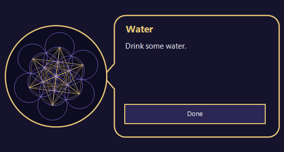

# BreakBuddy

Gentle reminders for people who forget to look after themselves at the computer.
BreakBuddy watches whether you are using your Windows PC and, only while you are, pops up a small
friendly reminder to drink water, eat, take a break, stretch, or go to bed.



**Out of the box it does one thing: a water reminder every hour while you are at the computer.**
Meals, bedtime, breaks, stretching, and rest days are all optional and set up by asking you a few questions.

## Set it up with your AI (easiest)

1. Download this repository (green **Code** button, then **Download ZIP**) and unzip it somewhere you will keep it,
   for example `Documents\BreakBuddy`. Or `git clone` it.
2. Open the folder in your AI coding assistant (Claude Code, Codex, Cursor, and similar), or drag the folder
   or [SETUP.md](SETUP.md) into your AI chat.
3. Say: **"Set up BreakBuddy for me."**

The AI follows [SETUP.md](SETUP.md): it asks when you eat, when you sleep, and which extras you want,
writes your `config.json`, runs the tests, and installs it. A chat-only AI that cannot run commands will
give you the file and the commands to paste instead.

## Set it up by hand

From the BreakBuddy folder, in PowerShell:

```powershell
powershell -NoProfile -ExecutionPolicy Bypass -File .\install.ps1
```

This creates `config.json` from [config.example.json](config.example.json) (hourly water only) and starts
BreakBuddy at every login. Edit `config.json` to add meals, sleep, and extras; the format is described in
[SETUP.md](SETUP.md#4-write-the-config-and-install). Changes apply within about 15 seconds, no restart.

## What it does

| Reminder | Default | When it appears |
|---|---|---|
| Water | **On**, every 60 min | While you are using the computer |
| Meals | Off | Inside each meal window you set, until you press Ate |
| Bedtime | Off | A wind-down warning before bed, then bedtime reminders while you are still on the computer |
| Breaks | Off | After a long unbroken stretch of use; offers a 15 or 25 minute break |
| Stretch | Off | Every 30 min of use |
| Rest days | Off | One gentle nudge on the days you choose |

While sleep is on, daytime reminders stay quiet from your wind-down until your wake time.
Stepping away for 10 minutes resets the work clock. Every popup has buttons; ignoring one only means it asks again later.

## Requirements

- Windows 10 or 11 (uses the built-in Windows PowerShell 5.1; nothing to install)
- No administrator rights, no internet, no accounts. Nothing leaves your computer.

## Files

| File | Purpose |
|---|---|
| `buddy.ps1` | Background loop and the popup window |
| `engine.ps1` | All reminder logic (no UI, fully tested) |
| `test.ps1` | Simulated-day tests: `powershell -ExecutionPolicy Bypass -File .\test.ps1` |
| `config.example.json` | Default settings |
| `install.ps1` / `uninstall.ps1` | Start at login / remove |
| `SETUP.md` | Step-by-step guide your AI follows |

Your own `config.json`, `state.xml`, and `buddy.log` stay on your machine and are ignored by git.

## Uninstall

```powershell
powershell -NoProfile -ExecutionPolicy Bypass -File .\uninstall.ps1
```

Then delete the folder.

## License

[MIT](LICENSE)
